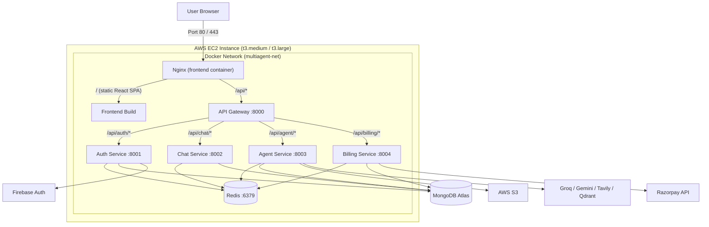

# Deployment Guide — Nexora AI

Deploying the complete **Nexora AI** platform (Vite React SPA + API Gateway + Auth + Chat + Agent + Billing microservices + Redis) to **AWS EC2** using Docker Compose and Nginx.

---

## Table of Contents

1. [Architecture Overview](#1-architecture-overview)
2. [Prerequisites](#2-prerequisites)
3. [Launch an EC2 Instance](#3-launch-an-ec2-instance)
4. [Configure the Security Group](#4-configure-the-security-group)
5. [Configure Environment Variables](#5-configure-environment-variables)
6. [Deploy](#6-deploy)
7. [Add TLS with Certbot](#7-add-tls-with-certbot)
8. [Verification](#8-verification)
9. [Day-2 Operations](#9-day-2-operations)
10. [Troubleshooting](#10-troubleshooting)
11. [GitHub Actions Deployment](#11-github-actions-deployment)

---

## 1. Architecture Overview



> All microservices run inside Docker's private bridge network. **Only ports 22, 80 and 443 should ever be open to the internet.**

---

## 2. Prerequisites

- An AWS account and an existing EC2 key pair (`deploy-key.pem`)
- A MongoDB database (MongoDB Atlas free tier is ideal)
- A Firebase project with **Google** sign-in enabled
  - Firebase Console → Project settings → Service accounts → *Generate new private key*
  - Download the JSON and keep it **out of the repository**
- API keys for the providers you want to enable (Groq, Google Gemini, Tavily, Qdrant, Razorpay)
- Docker installed locally (for the one-time image build, if you prefer to build before pushing)

---

## 3. Launch an EC2 Instance

1. Open the [AWS EC2 Console](https://console.aws.amazon.com/ec2/) in your region (e.g. `ap-south-1` Mumbai).
2. **Launch instance**:
   - **Name**: `nexora-ai-server`
   - **OS (AMI)**: `Ubuntu Server 24.04 LTS` (or `22.04 LTS`) — 64-bit (x86_64)
   - **Instance type**: `t3.medium` (2 vCPU / 4 GiB) minimum, `t3.large` (2 vCPU / 8 GiB) recommended
     > 5 Node.js services + Redis + the Vite build need at least 3–4 GB RAM. The deploy script adds 4 GB of swap as a safety net.
   - **Key pair**: your existing key pair associated with `deploy-key.pem`
   - **Storage**: at least **25 GiB** gp3 root volume
   - **IAM instance profile** (optional but recommended): grants S3 access without static keys

---

## 4. Configure the Security Group

| Type | Protocol | Port | Source | Purpose |
| :--- | :--- | :--- | :--- | :--- |
| **SSH** | TCP | `22` | *My IP* | Remote administration |
| **HTTP** | TCP | `80` | `0.0.0.0/0` | Web traffic |
| **HTTPS** | TCP | `443` | `0.0.0.0/0` | TLS traffic (after Certbot) |

Do **not** open 8000–8004 or 6379 — they are internal to the Docker network.

---

## 5. Configure Environment Variables

The application reads all configuration from a single `.env` file in `~/app`.

```bash
ssh -i deploy-key.pem ubuntu@<EC2_PUBLIC_IP>
mkdir -p ~/app
nano ~/app/.env
```

### Required

```env
# ---- Core ----
FRONTEND_URL=http://<YOUR_EC2_PUBLIC_IP>
INTERNAL_SERVICE_SECRET=<openssl rand -hex 32>

# ---- Database ----
MONGODB_URI=mongodb+srv://<user>:<password>@<cluster>.mongodb.net/nexora?retryWrites=true&w=majority

# ---- AI providers ----
GROQ_API_KEY=gsk_...
GOOGLE_API_KEY=AIzaSy...
GEMINI_API_KEY=AIzaSy...

# ---- Firebase Admin (path to the uploaded service account JSON) ----
FIREBASE_SERVICE_ACCOUNT_PATH=/home/ubuntu/app/serviceAccountKey.json
```

### Optional integrations

```env
TAVILY_API_KEY=tvly-...                    # web search agent
QDRANT_URL=https://...                      # RAG agent
QDRANT_API_KEY=...
AWS_REGION=ap-south-1                      # S3 artifact storage
AWS_ACCESS_KEY_ID=AKIA...
AWS_SECRET_KEY=...
AWS_BUCKET_NAME=your-bucket
RAZORPAY_KEY_ID=rzp_live_...               # paid plans
RAZORPAY_KEY_SECRET=...

# ---- Cookies (flip to true once TLS is configured) ----
COOKIE_SECURE=false
COOKIE_SAME_SITE=lax
```

> `RAZORPAY_KEY_ID` **and** `RAZORPAY_KEY_SECRET` are both required — the checkout flow cannot start without the key id.

### Uploading the Firebase service account

```bash
scp -i deploy-key.pem serviceAccountKey.json ubuntu@<EC2_PUBLIC_IP>:~/app/
chmod 600 ~/app/serviceAccountKey.json
```

> The file lives **only** on the server. It is excluded from `.gitignore`, the Docker build context and the rsync transfer.

---

## 6. Deploy

### Option A — the automated script (from your workstation)

```bash
chmod 400 deploy-key.pem
./deploy-to-ec2.sh <YOUR_EC2_PUBLIC_IP>
```

The script:

1. Validates SSH connectivity.
2. Installs Docker + the Compose plugin and provisions 4 GB of swap.
3. Rsyncs the clean source tree to `~/app` (excluding `.env`, `node_modules`, `dist`, keys).
4. Validates the remote `.env` and the Compose file.
5. Runs `docker compose -f docker-compose.prod.yml up -d --build`.

### Option B — manually, on the server

```bash
ssh -i deploy-key.pem ubuntu@<EC2_PUBLIC_IP>
cd ~/app
sudo docker compose -f docker-compose.prod.yml up -d --build
sudo docker compose -f docker-compose.prod.yml ps
```

### Installing Docker manually (if not using the script)

```bash
sudo apt-get update -y
sudo apt-get install -y ca-certificates curl gnupg
sudo install -m 0755 -d /etc/apt/keyrings
curl -fsSL https://download.docker.com/linux/ubuntu/gpg | sudo gpg --dearmor -o /etc/apt/keyrings/docker.gpg --yes
sudo chmod a+r /etc/apt/keyrings/docker.gpg
echo "deb [arch=$(dpkg --print-architecture) signed-by=/etc/apt/keyrings/docker.gpg] https://download.docker.com/linux/ubuntu $(. /etc/os-release && echo "$VERSION_CODENAME") stable" | sudo tee /etc/apt/sources.list.d/docker.list > /dev/null
sudo apt-get update -y
sudo apt-get install -y docker-ce docker-ce-cli containerd.io docker-buildx-plugin docker-compose-plugin
sudo usermod -aG docker $USER && newgrp docker
```

---

## 7. Add TLS with Certbot

The app is served over HTTP by default. To enable HTTPS:

```bash
sudo apt-get install -y certbot python3-certbot-nginx
sudo certbot --nginx -d your-domain-or-ip
```

Then update `.env` and restart the stack so the session cookie becomes secure:

```env
FRONTEND_URL=https://your-domain-or-ip
COOKIE_SECURE=true
COOKIE_SAME_SITE=lax
```

```bash
cd ~/app && sudo docker compose -f docker-compose.prod.yml up -d
```

> **Why this matters:** `navigator.clipboard` is only available in secure contexts. Over plain HTTP the "Copy" buttons fall back to `document.execCommand`, which still works — but HTTPS is strongly recommended.

---

## 8. Verification

```bash
cd ~/app

# Container status - every service should report "healthy"
sudo docker compose -f docker-compose.prod.yml ps

# Health endpoints
for p in 8000 8001 8002 8003 8004; do
  echo -n "$p -> "
  sudo docker compose -f docker-compose.prod.yml exec -T gateway \
    node -e "require('http').get('http://127.0.0.1:$p/health', r => { console.log(r.statusCode); process.exit(0) }).on('error', () => { console.log('ERR'); process.exit(1) })"
done

# Public check
curl -I http://<YOUR_EC2_PUBLIC_IP>
```

Expected output: all containers `Up (healthy)` and every port returning `200`.

---

## 9. Day-2 Operations

```bash
cd ~/app

# Follow all logs
sudo docker compose -f docker-compose.prod.yml logs -f

# Follow one service
sudo docker compose -f docker-compose.prod.yml logs -f agent

# Restart a single service
sudo docker compose -f docker-compose.prod.yml restart agent

# Apply a configuration change (e.g. new .env)
sudo docker compose -f docker-compose.prod.yml up -d

# Roll back to the previous image
sudo docker compose -f docker-compose.prod.yml up -d --no-build

# Stop everything (volumes are preserved)
sudo docker compose -f docker-compose.prod.yml down

# Stop and wipe all data
sudo docker compose -f docker-compose.prod.yml down -v
```

### Backup

Session and conversation data live in MongoDB Atlas (which has its own backups) and Redis (ephemeral by design). S3 artifacts persist independently. Nothing on the EC2 instance needs backing up beyond `~/app/.env` and `~/app/serviceAccountKey.json`.

---

## 10. Troubleshooting

| Symptom | Cause | Fix |
|---|---|---|
| `auth` container restarts repeatedly | `serviceAccountKey.json` missing or `FIREBASE_SERVICE_ACCOUNT_PATH` wrong | `docker compose logs auth` — confirm the path exists and is readable |
| All services unhealthy | `MONGODB_URI` invalid | Check the URI is URL-encoded and the Atlas IP allow-list includes the EC2 IP |
| CORS error in the browser console | `FRONTEND_URL` does not match the browser origin | Set `FRONTEND_URL` to the exact origin (no trailing slash, include `https://`) |
| Login succeeds but the app stays on the sign-in screen | Session cookie rejected | Set `COOKIE_SECURE=true` only when actually serving over HTTPS |
| `403 Forbidden` on plan activation | `INTERNAL_SERVICE_SECRET` missing or mismatched between services | It must be identical in `.env` — it is read by auth, billing and agent |
| Agent calls fail with "No AI provider is configured" | `GROQ_API_KEY` / `GOOGLE_API_KEY` missing | Set at least one provider key and restart the agent container |
| Artifact download returns 404 | File already cleaned up or a path mismatch | Artifacts live in the agent container's `temp/` volume — check `docker compose logs agent` |
| Out of memory on `t3.micro` | Too many services for 2 GB RAM | Use `t3.medium`+ — the deploy script already adds swap |
| Image build fails on `npm ci` | Lockfile out of sync with `package.json` | Run `npm install --package-lock-only` in that service and commit the result |

---

## 11. GitHub Actions Deployment

The repository ships with two workflows:

| Workflow | Trigger | Purpose |
|---|---|---|
| `ci.yml` | Push / PR to `main` | Unit tests, lint, build, service boot check, Docker image builds |
| `deploy.yml` | Manual (`workflow_dispatch`) | Deploys to EC2 over SSH + rsync, then verifies every health endpoint |

### Required repository secrets

| Secret | Value |
|---|---|
| `EC2_SSH_KEY` | The **private** key contents (`deploy-key.pem`) |
| `EC2_HOST` | The EC2 public IP or DNS name |

### Running a deployment

1. Go to **Actions → Deploy to EC2**.
2. Click **Run workflow**.
3. Choose the target: `all`, or a single service (`frontend`, `agent`, `chat`, `auth`, `billing`, `gateway`).
4. Watch the logs — the workflow verifies the gateway and every service health endpoint before reporting success.

> The remote `~/app/.env` is never overwritten by the deployment, so production secrets stay on the server.
